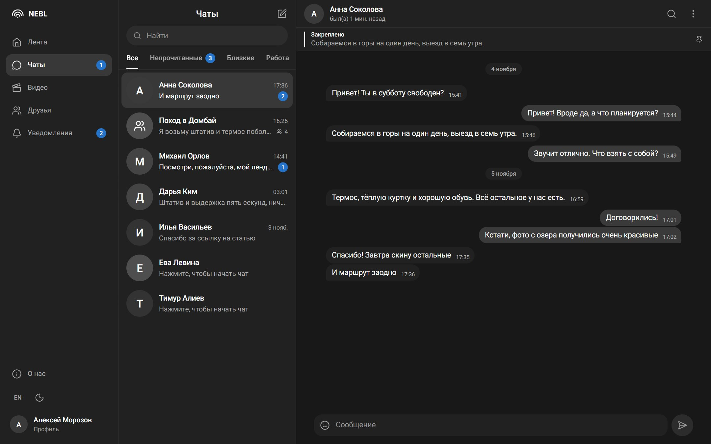
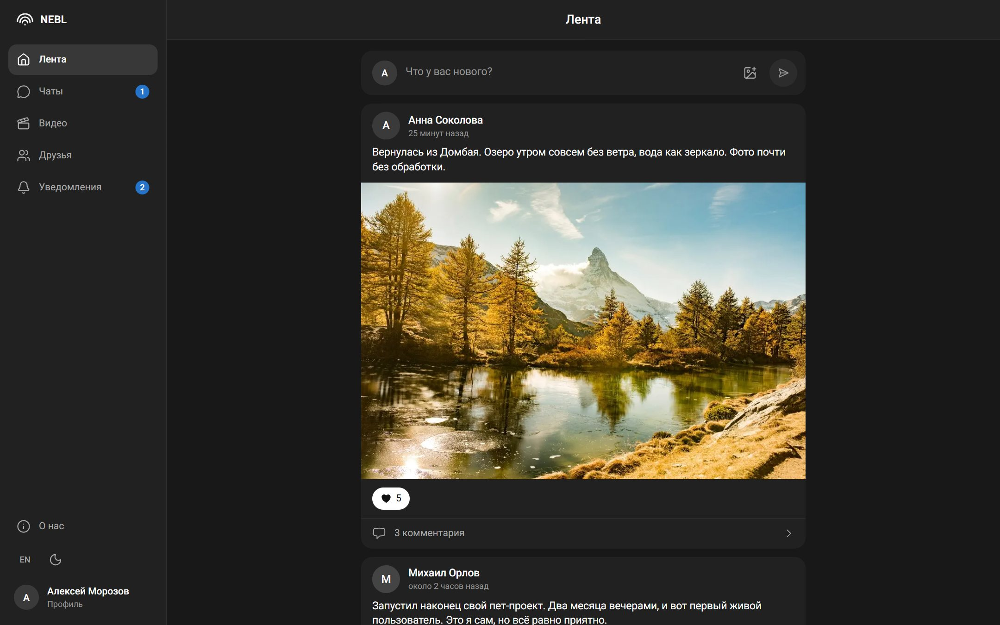
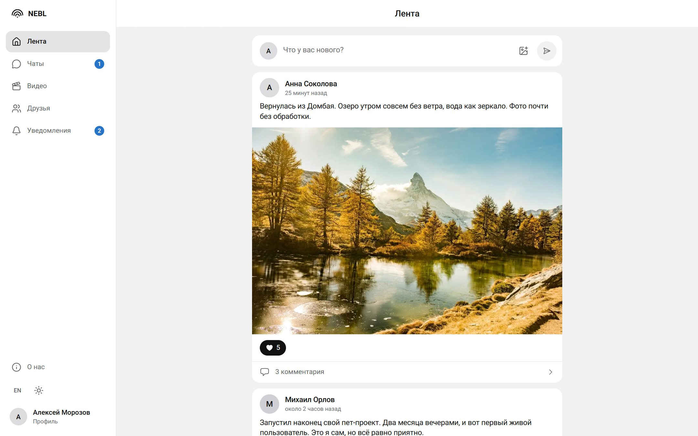
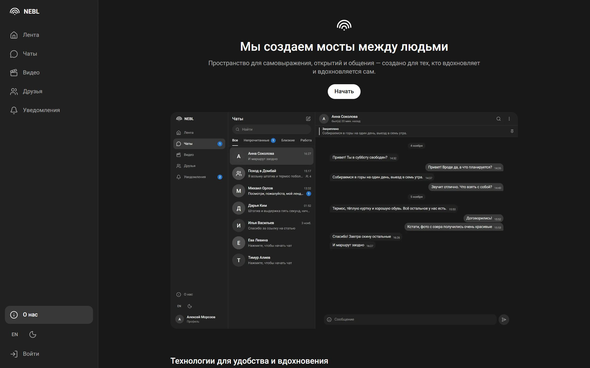
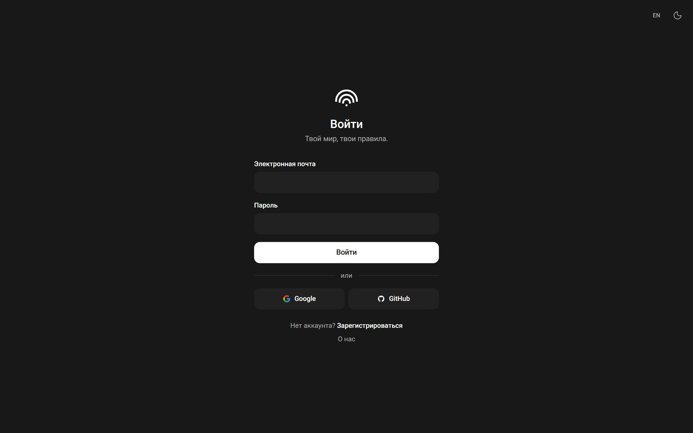
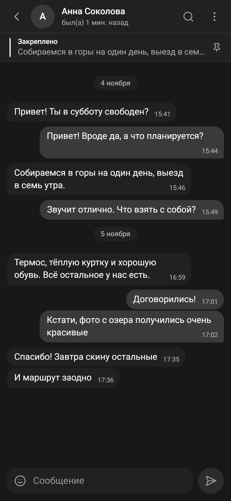

# NEBL — социальная сеть

Full-stack социальная сеть на **Next.js 16 (App Router)**, **React 19**, **TypeScript**, **Prisma** и **PostgreSQL**: лента постов, короткие видео (рилсы), личные и групповые чаты, друзья и уведомления. Интерфейс на двух языках (RU / EN), минималистичный дизайн в духе тёмной темы Telegram, есть светлая тема и мобильная версия с нижним таб-баром.

**[Открыть демо →](https://social-theta-amber.vercel.app/)** · регистрация по email или вход через GitHub и Google



## О проекте

Проект закрывает полный цикл веб-приложения: регистрация и OAuth, база данных с миграциями, REST API с проверкой прав, загрузка файлов и обновления в реальном времени. Бэкенд написан на Route Handlers Next.js, без готовых BaaS-сервисов.

- **6 разделов:** лента, рилсы, чаты, друзья, уведомления и профиль.
- **Реальное время:** счётчики в навигации обновляются через Server-Sent Events без перезагрузки страницы.
- **Безопасность на сервере:** каждый изменяющий запрос проверяет сессию и права на ресурс, пароли хешируются bcrypt.

## Возможности

- **Аутентификация** — email + пароль (bcrypt) и OAuth через Google и GitHub (Auth.js v5, JWT-сессии). Приватные страницы закрыты на уровне `proxy.ts`.
- **Лента** — посты с текстом и фото, лайки, комментарии, удаление своих постов, догрузка по страницам. Фото сжимаются в браузере (canvas) перед загрузкой.
- **Рилсы** — вертикальная лента видео с автовоспроизведением в зоне видимости (IntersectionObserver) и лайками. Загрузка видео до 60 секунд и 100 МБ: вертикальное превью, прогресс, автоматическая обложка из первого кадра. Просмотры считаются один раз на пользователя.
- **Чаты**
  - личные сообщения: статус «в сети / был(а) в…», поиск по переписке, закреплённые сообщения, удаление сообщений и очистка чата;
  - групповые чаты с ролями владельца и участника, голосовые сообщения (MediaRecorder);
  - папки для чатов, фильтр непрочитанных, счётчики непрочитанных.
- **Друзья** — поиск людей, заявки в друзья, принятие/отклонение, удаление из друзей.
- **Уведомления** — о лайках, комментариях и заявках в друзья; счётчики в навигации обновляются в реальном времени через **Server-Sent Events**.
- **Профиль** — смена аватара и никнейма, статистика, публичные профили пользователей.

## Скриншоты

| Лента, тёмная тема                                               | Лента, светлая тема                                                     |
| ---------------------------------------------------------------- | ----------------------------------------------------------------------- |
|  |  |

| Страница «О нас»                                                                 | Вход по email, через Google или GitHub             |
| -------------------------------------------------------------------------------- | -------------------------------------------------- |
|  |  |



На скриншотах демо-данные: имена вымышлены, фото из открытых источников под лицензией CC0 (rawpixel, WordPress Photo Directory).

## Стек

| Слой          | Технологии                                                               |
| ------------- | ------------------------------------------------------------------------ |
| Frontend      | Next.js 16, React 19, TypeScript, Tailwind CSS 4, lucide-react, date-fns |
| Backend       | Next.js Route Handlers, Auth.js (next-auth v5), Server-Sent Events       |
| База данных   | PostgreSQL, Prisma ORM (миграции в `prisma/migrations`)                  |
| Качество кода | ESLint (next/core-web-vitals + TypeScript), Prettier, строгий `tsc`      |

## Технические решения

- **Оптимистичные обновления** — лайки, комментарии и сообщения появляются сразу и откатываются, если запрос не прошёл.
- **Пагинация** — курсорная для сообщений и рилсов, постраничная для ленты. Фоновый опрос чата обновляет только последнюю страницу и не сбрасывает уже загруженную историю.
- **Проверка доступа на сервере** — изменяющие данные роуты проверяют сессию и права на ресурс (посты, комментарии, папки, групповые чаты).
- **Загрузка файлов** — общий хелпер `lib/upload.ts` проверяет MIME-тип и размер и генерирует имя файла на сервере.
- **i18n и тема без ошибок гидрации** — язык и тема хранятся в `localStorage` и читаются через `useSyncExternalStore` (`app/hooks/useStoredValue.tsx`).

## Структура проекта

```
app/
  api/            REST-эндпоинты (Route Handlers)
  components/     компоненты: auth, chat, feed, profile, shell (навигация), ui (аватар, диалоги, состояния)
  hooks/          клиентские хуки (тема, язык, онлайн-статус, счётчики)
  translation/    словари RU / EN
  types/          общие TypeScript-типы
  chat/ friends/ notifications/ profile/ reels/ about/ login/ register/   страницы
lib/              Prisma client, загрузка файлов
prisma/           схема и миграции БД
auth.ts           конфигурация Auth.js
proxy.ts          защита приватных маршрутов
```

## Запуск локально

Нужны Node.js 20+ и PostgreSQL.

```bash
npm install
cp .env.example .env        # заполните DATABASE_URL и AUTH_SECRET
npx prisma migrate dev      # создаёт таблицы
npm run dev                 # http://localhost:3000
```

OAuth-ключи Google и GitHub нужны только для входа через эти сервисы; регистрация по email работает без них.

## Скрипты

| Команда                       | Что делает                |
| ----------------------------- | ------------------------- |
| `npm run dev`                 | dev-сервер                |
| `npm run build` / `npm start` | продакшн-сборка и запуск  |
| `npm run lint`                | ESLint                    |
| `npm run typecheck`           | проверка типов TypeScript |
| `npm run format`              | форматирование Prettier   |

> Видео рилсов браузер загружает напрямую в Vercel Blob, если задан `BLOB_VIDEOS_READ_WRITE_TOKEN`; без токена они сохраняются в `public/uploads`. Фото и аватары пока всегда пишутся в `public/uploads` (исключена из git), поэтому на serverless-хостинге их тоже стоит перенести в объектное хранилище.

## Автор

Никита Чурсинов — [GitHub](https://github.com/Chursinov-Nikita)
